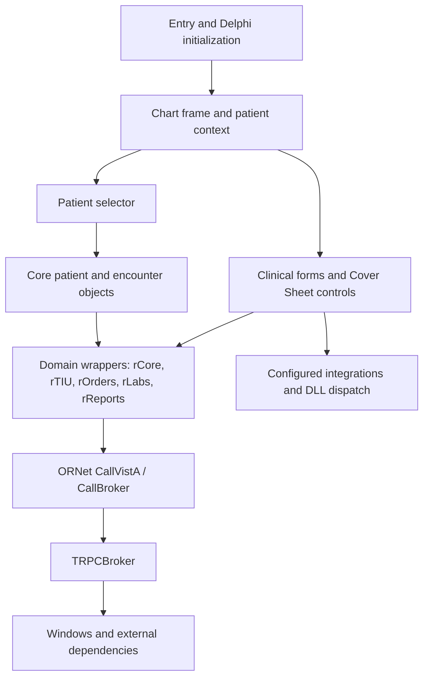

# CPRS Chart architecture specification

Specimen: **CPRSChart.exe 1.33.214.5**, PE32/x86, Delphi. SHA-256: `7e8800aeafc0ccff347d04d9a64b51bb64a04a6935131f06ce1e730392493544`. The uploaded executable and MAP exactly match the historical focused exports. Version words in `VS_FIXEDFILEINFO` at `0x0155ba84` encode 1.33.214.5. This identifies the specimen; distribution authenticity and an exact Pascal source snapshot are not established.

This document specifies observed static architecture and its limits. [Coverage](catalog/coverage.json) distinguishes inventory classification from semantic recovery. [Behavior](BEHAVIOR.md), [data](DATA-STRUCTURES.md), [interfaces](EXTERNAL-INTERFACES.md), [inventory](FUNCTION-INVENTORY.md), and [reimplementation](REIMPLEMENTATION-PLAN.md) are companion deliverables. None of the analyzed target code has been executed.

## Program organization

The image base is `0x00400000`; the entry point is `0x01224034`, named `CPRSChart.CPRSChart` by the MAP. The entry is in `.itext`. The 14,798,584-byte `.text` section contains executable code interleaved with Delphi class metadata and literal pools, so executable-section membership does not establish that bytes are instructions. Other sections include `.data`, `.bss`, normal/delayed import tables, exports, TLS, read-only data and resources. [Program metadata](evidence/inventory-final/program.json) and [MAP module regions](evidence/static/map-modules.json) preserve exact ranges.

The MAP supplies 65,610 unique file-backed public symbols and 1,725 module regions across segment classes. Public symbols include routines, globals, class metadata, generated generic helpers and constants. Only Ghidra function-manager entries are counted in the function inventory. The 2,554 validated class metadata records provide class identity, instance extent, and parent-reference evidence; they do not recover all instance fields.

The resource tree contains 590 resources. All 325 resources beginning with binary-form marker `TPF0` were decoded with complete consumption. Their 4,371 stored event bindings connect forms and controls to named methods; each binding retains candidate MAP matches. Runtime inheritance, reassignment, visibility, configuration and dispatch can change effective behavior. See [resources](evidence/static/resources.json), [forms](evidence/static/forms), and [event bindings](evidence/static/form-bindings.jsonl).

## Layering and control flow

This diagram summarizes static associations. It does not imply every page follows one pure layer, that every edge executes, or that a visual reading path has no write-related calls. Cross-subsystem call counts and unresolved edges are preserved in [the graph catalog](catalog/subsystem-call-graph.json).

## Subsystems

| Subsystem | Address anchors and supported role | Unresolved boundary |
| --- | --- | --- |
| Startup and chart shell | Entry `01224034`; frame creation `00fee504`; patient setup `00ff1f14`; patient info panel `00ff2f08`; tab change `00ff1ae8` | Full startup options, saved preferences, event ordering and all tab-specific lifecycle branches |
| Patient selection/context | Selector `00e81038`; candidate change `00e825c4`; paged data callback `00e82980`; OK `00e82d44`; commit `00e8303c`; patient setter `011d4918` | Alias/paging edge cases, duplicate identities, sensitive-access/audit semantics, CCOW cancellation and encounter defaults |
| Broker and transport | `ORNet.CallVistA` overloads beginning `009ad778`; central overload `009ada80`; `CallBroker` `009af1ec`; `TRPCBroker.Call` `0099f884` | Full serialization, secure-session negotiation, error taxonomy, retry policy and production authentication contracts |
| Cover Sheet composition | Service clearing `00bee374`; display `00bee478`; switching patient `00bef080`; initialization `00bef608`; common detail dispatch `00bd41b4` | Site-driven control lists, configured interface implementations and complete lifecycle ordering |
| Notes and TIU | Page display `00e146cc`; loading `00e21f14`; selection `00e19480`; document text wrapper `00a0b870` | Editor state, locking, signature authorization, rich text and full document metadata layout |
| Orders, medication and consult workflows | Orders refresh `0117b000`; visible-field retrieval `0117e3f0`; detail handler `0117cc00`; abbreviated wrappers `011dc634`, `011dcb68`, `011dccc0` | Complete ordering/editing state machine, order checks, ordering dialogs, release/signature policy and server-side effects |
| Results, reports and graphs | Lab page `00ea4504`; report selection `00eb4c1c`; date selection `00ea9ee4`; report wrapper `00c03f50`; interim wrapper `00c867c8` | Dynamic report configuration, remote sites, graph contracts, report-specific response schemas and date semantics |
| Vitals and integrations | Vitals show override `00be22f4`; update dispatch `00be2334`; `ViewPatientVitals` `00ae6cb0` | DLL internals, configured entry points, permission-dependent behavior and clinical effects |
| Shared UI/runtime | Delphi/VCL, common OR controls, accessibility helpers and generated collections are represented by their MAP modules | Module attribution is evidence-backed; grouping by logical subsystem is provisional and does not imply semantic analysis of each library routine |

Every discovered function is assigned a physical module when possible and a logical subsystem with its assignment basis. Modules outside the reviewed domains remain explicitly classified as other application modules rather than silently omitted. [Subsystem catalog](catalog/subsystems.json) lists all member modules and status counts.

## Ownership and state boundaries

`SelectPtByDFN` calls `TPatient.SetDFN` at `0x00e830cb`, clears encounter at `0x00e830d7`, and clears changes at `0x00e830e3`. `TPatient.SetDFN` in turn calls `rCore.SelectPatient` at `0x011d496c`. These edges establish separate patient, encounter, change-tracking and retrieval responsibilities. They do not establish transactional atomicity or concurrency policy.

Clinical pages have explicit patient-clearing methods. Notes `00e14524`, Orders `01179ba0`, Labs `00ea4440`, and Cover Sheet service `00bee374` are distinct reset paths. Shared Cover Sheet controls dispatch clearing through virtual/interface calls. Runtime scheduling and event ordering require further reconstruction.

The UI uses both concrete controls and virtual/interface dispatch. In particular, Vitals overrides the shared detail-show path: its VMT routes slot `0x214` to `00be22f4`, and that method routes slot `0x238` toward `00be2334`. Shared visual appearance therefore does not imply identical action semantics.

## External boundaries

The executable has 803 normal imports and 638 delayed imports. Imports establish dependencies on Windows UI, sockets, HTTP, COM, cryptography, smart cards, printing, and memory management. They do not establish that every facility is used in a particular workflow. The archive additionally supplies five DLLs; their filenames and hashes are cataloged, while their full implementations remain outside this executable's recovered behavior.

There are 26,025 structurally validated Delphi managed-literal candidates, including 1,154 RPC-like names. Cross-references and wrapper analysis distinguish actual use-site evidence from names merely present in the image. Dynamic RPC names are a material interface boundary: a missing fixed literal cannot be replaced with an invented API name.

## Fidelity limits

The historical Rust application is an authored synthetic prototype. Its invented fixtures, generation guards, layouts, status labels, filters and read-only action choices are not recovered CPRS behavior. This specification uses historical assembly, string annotations and resources only after identity/byte validation; it does not inherit prototype behavior as executable evidence.

Automatic analysis, MAP naming and decompiler output remain fallible. Function discovery may contain false boundaries and miss callback/exception continuations. Invalid-image-data and decompiler-flow warnings are retained in the analysis log. The unresolved-function census, indirect call sites and missing historical entries are durable follow-up work, not an assertion of whole-program behavioral equivalence.
